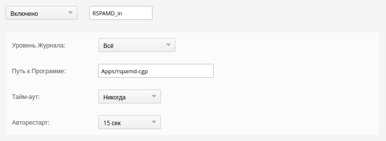
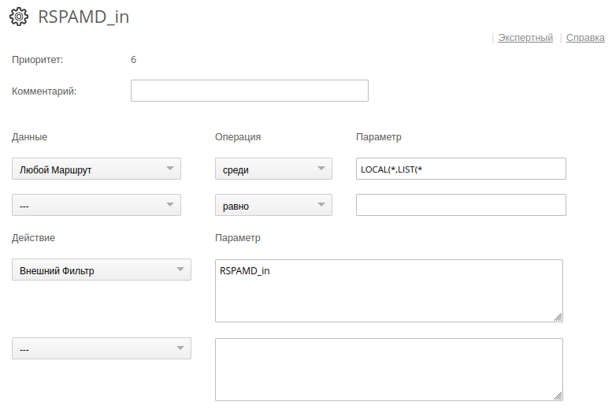
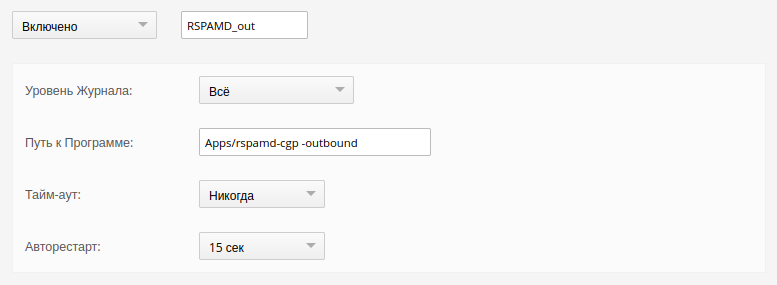
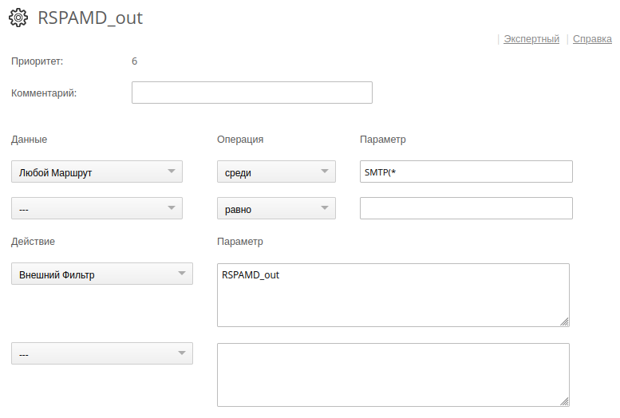

[](#) [](README.ru.md)

## Rspamd helper for CommuniGate Pro 6.x, *version 3.0.0*

### Introduction

The **rspamd-cgp** *Helper* (external message filter) is designed for spam filtering. It receives messages from *CommuniGate Pro* and passes them to *Rspamd* for processing.<br/><br/>

### Features

* **High Performance:** Starting with version 3.0.0, the *Helper* utilizes *streaming* data processing. This ensures near-constant memory consumption and a significant reduction in allocations, regardless of the processed message size. This makes the filter stable even when handling exceptionally large attachments.

* The *Helper* receives messages from *CommuniGate Pro* via the *External Filter Interface* protocol and transmits them to *Rspamd* using the *Rspamd protocol*.

* If a message is received from an authenticated source, the *Helper* passes the `Auth:` header in the *Rspamd protocol*.

* The *Helper* determines the SMTP `HELO/EHLO` identity based on the first `Received:` header of the message and passes the `Helo:` header in the *Rspamd protocol*.

* The *Helper* performs reverse DNS lookup for the message source IP address. If successful, it passes the `Hostname:` header in the *Rspamd protocol*. Lookup results are cached.

* The *Helper* distinguishes between messages received from external sources and those generated by *CommuniGate Pro*. When passing generated messages to *Rspamd*, the *Helper* marks them as originating from a trusted source.

* The *Helper* generates the `X-Junk-Score:` header based on the *action* returned by *Rspamd*. This header is processed by the built-in *Spam Management* rules configured in the *CommuniGate Pro* user interface.

* The *Helper* adds all headers received from *Rspamd* to the message. The decision to include these headers is made on the *Rspamd* side.

* Upon receiving an `action: rewrite subject`, the *Helper* rewrites the message `Subject:` as specified in the *Rspamd* response. This operation triggers the message to pass through the *CommuniGate Pro PIPE*.

* In certain scenarios, to prevent double processing or message looping, the *Helper* adds an `X-Rspamd-Seen:` header to the processed message.

* The *Helper* can perform additional message processing based on its configuration file using data from the *Rspamd* response. Additional processing can be applied to both *actions* and *symbols*. If multiple *actions* and *symbols* match in the configuration file for a specific message, the results are aggregated.

* The *Helper* can process outbound messages. This allows utilizing various *Rspamd* modules to reduce False Positives (FP).

### Installation

The *Helper* configuration file [rspamd-cgp.yml](rspamd-cgp.yml) is located by default in the same directory as the **rspamd-cgp** executable. An alternative configuration file path can be specified via the command line. All available settings are described in detail within the configuration file.

> Below are the *Helper* settings and *Rules* within the *CommuniGate Pro* interface.

#### For Inbound Messages

##### Settings -> General -> Helpers


##### Settings -> Mail -> Rules -> RSPAMD_in


#### For Outbound Messages

##### Settings -> General -> Helpers


##### Settings -> Mail -> Rules -> RSPAMD_out


#### Command Line Arguments

```
    Usage of rspamd-cgp:
      -config string
            Set configuration file (default "rspamd-cgp.yml")
      -configdump
            Perform configuration file dump
      -configtest
            Perform configuration file test
      -debug
            Run in debug mode
      -outbound
            Outbound message flow processing
      -version
            Print version and exit
```

**config**

Specifies an alternative configuration file.

**configdump**

Outputs the configuration file in a formatted view.

**configtest**

Verifies the syntactic correctness of the configuration file.

**debug**

Outputs the *Rspamd* response (JSON) in a formatted view. Can be used to monitor *symbols* and other data returned by *Rspamd*. The input file must be in the *CommuniGate Pro* queue file format. ***Use only when running from the command line!!!***

**outbound**

Processes the outbound message flow. If outbound messages are sent to external MTAs, spam check headers are not added. The specific messages to be processed in this mode are determined by the *CommuniGate Pro Rule*.

<br/>

### License

BSD License, [LICENSE.md](LICENSE.md)<br/><br/>

### Author

Andrey Igoshin <<ai@vsu.ru>><br/><br/>

### Links

* Repository: <https://git.vsu.ru/ai/rspamd-cgp>
* CommuniGate Pro Website: <https://communigatepro.ru>
* Helper Protocol: <https://doc.communigatepro.ru/russian/development/Helpers.html#Filters>
* Rspamd Website: <https://rspamd.com>
* Rspamd Protocol: <https://rspamd.com/doc/developers/protocol.html>
