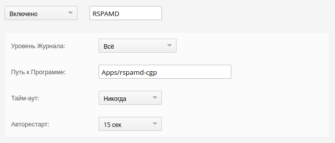
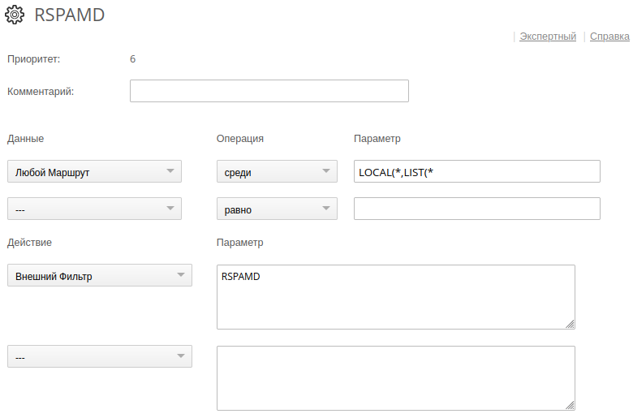

## Rspamd helper for CommuniGate Pro 6.x, *версия 2.0.0*

### Введение

*Помощник* (внешний фильтр сообщений) **rspamd-cgp** используется для фильтрования спама. Он получает сообщения от *CommuniGate Pro* и передаёт их для обработки в *Rspamd*.<br/><br/>

### Установка

Конфигурационный файл [rspamd-cgp.yml](rspamd-cgp.yml) по умолчанию находится в той же директории, что и исполняемый файл **rspamd-cgp**. При необходимости, другое местоположение конфигурационного файла можно указать в командной строке.
Возможные настройки **rspamd-cgp** подробно описаны в конфигурационном файле.

> Ниже показаны настройки *Помощника* и *Правила* в интерфейсе *CommuniGate Pro*.

*Установки -> Общее -> Помощники*


> *Помощник* **rspamd-cgp** корректно обрабатывает сообщения, которые уже передавались на обработку, поэтому дополнительные условия в *Правиле* не требуются.

*Установки -> Почта -> Правила -> RSPAMD*


#### Параметры командной строки

```
    Usage of rspamd-cgp:
      -config string
            Set configuration file (default "rspamd-cgp.yml")
      -configdump
            Perform configuration file dump
      -configtest
            Perform configuration file test
```
<br/>

### Лицензия

BSD License, [LICENSE.md](LICENSE.md)<br/><br/>

### Автор
 
Andrey Igoshin <<ai@vsu.ru>><br/><br/>

### Ссылки

* Репозиторий: <https://git.vsu.ru/ai/rspamd-cgp>
* Сайт Rspamd: <https://rspamd.com>